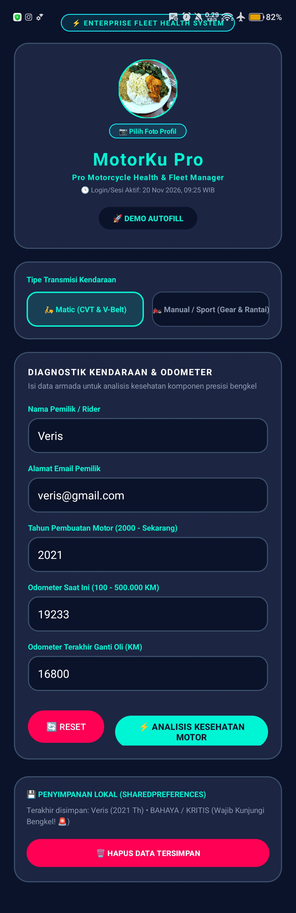
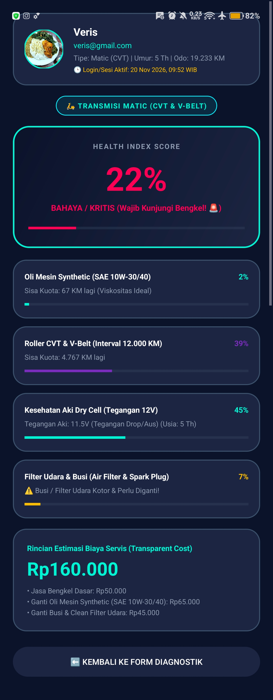

<div align="center">

# 🛵 MotorKu — Pro Motorcycle Health & Fleet Manager

<p align="center">
  <b>Enterprise-Grade Motorcycle Diagnostic & Fleet Health Management Application</b>
</p>

[](https://kotlinlang.org/)
[](https://developer.android.com/)
[](https://developer.android.com/training/data-storage/room)
[](https://material.io/)
[](https://github.com/)
[](https://github.com/)

---

</div>

## 📸 Pratinjau Tampilan & Dokumentasi (Screenshots & Video)

| Layar 1: Form Diagnostik & Local Storage | Layar 2: Dashboard HUD & Itemized Cost Breakdown |
| :---: | :---: |
|  |  |

> 📹 **Video Demo Aplikasi**: Lampirkan rekaman layar/GIF aplikasi kamu di folder `docs/demo.gif` atau di bagian *Releases* GitHub.

---

## 📌 Tentang Aplikasi

**MotorKu Pro** adalah aplikasi Android berbasis Kotlin berstandar enterprise yang dirancang khusus untuk mendiagnosa kesehatan sepeda motor (matic/manual/sport) secara presisi berdasarkan parameter riwayat odometer dan usia kendaraan dunia nyata. 

Aplikasi ini dilengkapi dengan **Penyimpanan Data Lokal (SharedPreferences & Room Database Framework)**, **Fitur Unggah Foto Profil Kustom**, serta **Sistem Pencatatan Waktu Login/Sesi Aktif Real-Time**. Mengolah kondisi komponen utama (Oli Mesin Synthetic SAE 10W-30/40, Sistem Transmisi Dinamis CVT vs Rantai Kit, Aki Dry Cell 12V, serta Filter Udara & Busi Pembakaran) untuk menghasilkan **Overall Health Index Score (0-100%)**, status kondisi kendaraan, serta **Itemized Cost Estimation (Rincian Biaya Servis Transparan)** secara instant.

Aplikasi ini dioptimalkan secara khusus untuk tampilan layar modern resolusi tinggi (*120Hz AMOLED feel*) dengan desain **Cyber Midnight Palette** yang futuristik, responsif, dan minim bug.

---

## ✨ Fitur Utama & Arsitektur Dinamis

### 1. 💾 Storage Lokal SharedPreferences (Pertemuan 9)
- **Auto Load Data Profil (`loadSavedData()`)**: Saat aplikasi ditutup sepenuhnya dan dibuka kembali, seluruh data input form (Nama, Email, Tahun Motor, Odometer, Odometer Oli, Tipe Transmisi, dan Status) terisi otomatis dari SharedPreferences.
- **Save After Validation Only**: Data hanya disimpan jika seluruh validasi input dinyatakan lolos dengan metode asinkron `apply()`.
- **Status HUD Storage**: Menampilkan widget status *storage* lokal terkini.
- **🗑️ Hapus Data Tersimpan (`btnHapusSimpan`)**: Tombol 1-klik untuk mengosongkan seluruh data tersimpan di SharedPreferences (`prefs.edit().clear().apply()`) serta me-reset form input dan foto profil.

### 2. 📷 Custom Foto Profil (Gallery Picker & Internal Storage)
- **Pemilihan Gambar dari Galeri**: Menggunakan modern `ActivityResultContracts.GetContent()` untuk memilih foto dari galeri HP pengguna.
- **Penyimpanan File Permanen**: Menyimpan gambar yang dipilih ke internal storage (`filesDir/user_avatar.jpg`) dan menyimpan path-nya di SharedPreferences (`KEY_AVATAR_PATH`).
- **Circular Avatar View**: Menampilkan foto profil bundar bermotif *cyber cyan border* (`ShapeableImageView`) di `MainActivity` dan `SecondActivity` (dengan *fallback* ke inisial nama rider).

### 3. 🕒 Pencatatan Waktu Login / Sesi Aktif
- **Timestamp Sesi Real-Time**: Mencatat waktu login/aktivitas pengguna secara otomatis dengan format tanggal Indonesia (misal: `20 Nov 2026, 09:30 WIB`).
- **Persistent Timestamp**: Timestamp disimpan di SharedPreferences (`KEY_WAKTU_LOGIN`) dan diteruskan ke Dashboard `SecondActivity`.

### 4. 🗄️ Kerangka Room Database Framework (Entity, DAO, Database)
- **Terintegrasi Library Room 2.8.5**: Menyiapkan fondasi database SQLite terstruktur untuk riwayat catatan/servis.
- **Entity**: `Catatan` (`@Entity(tableName = "catatan")`).
- **DAO**: `CatatanDao` (`@Dao` interface dengan fungsi `suspend`).
- **Database**: `AppDatabase` (`@Database` abstract class).

### 5. 🛵 Selector Transmisi Dinamis (Layar 1 ➔ Layar 2)
- Sakelar pilihan tipe transmisi dengan *glowing active state border*:
  - **🛵 Matic (CVT & V-Belt)**: Mengalihkan kalkulasi ke komponen Roller CVT & V-Belt (interval **12.000 KM**).
  - **🏍️ Manual / Sport (Gear & Rantai)**: Mengalihkan kalkulasi ke komponen Rantai & Gear Kit (interval **15.000 KM**).

### 6. 🚀 Fitur Demo Autofill & Instant Reset
- **🚀 DEMO AUTOFILL**: Mengisikan data pengujian valid secara instan tanpa mengetik manual.
- **🔄 RESET FORM**: Membersihkan seluruh isi input form sekaligus menghapus semua pesan error (`error = null`).

### 7. 🛡️ Validasi Berlapis Presisi Tinggi (Early Exit Pattern)
- **Validasi Kolom Kosong**: Focus otomatis ke field pertama yang belum diisi.
- **Validasi Email Presisi (Strict Regex)**: Menggunakan regex strict `^[A-Za-z0-9._%+-]+@[A-Za-z0-9.-]+\\.[A-Za-z]{2,6}$`.
- **Validasi Tahun Motor**: Rentang valid antara **tahun 2000 s/d Tahun Berjalan** (dinamis via `Calendar.getInstance()`).
- **Validasi Range Odometer**: Memastikan odometer berada di rentang **100 s/d 500.000 KM**.
- **Validasi Odometer Oli**: Odometer Oli Terakhir **tidak boleh melebihi** Odometer saat ini.

---

## 🧮 Logika Pemrosesan & Formula Kesehatan

| Komponen | Interval Standar | Formula Perhitungan Persentase |
| :--- | :--- | :--- |
| **Oli Mesin Synthetic** | 2.500 KM | `((2500 - (Odo - OdoOliTerakhir)) / 2500) * 100%` |
| **Roller CVT & V-Belt (Matic)** | 12.000 KM | `((12000 - (Odo % 12000)) / 12000) * 100%` |
| **Rantai & Gear Kit (Manual)** | 15.000 KM | `((15000 - (Odo % 15000)) / 15000) * 100%` |
| **Aki Dry Cell 12V** | Umur Motor | `<= 2 Th: 95% \| <= 4 Th: 70% \| <= 6 Th: 45% \| > 6 Th: 20%` |
| **Filter Udara & Busi** | 10.000 KM | `((10000 - (Odo % 10000)) / 10000) * 100%` |
| **Overall Health Index** | Terbobot | `(Oli * 35%) + (Transmisi * 35%) + (Aki * 15%) + (Filter * 15%)` |

---

## 📊 SharedPreferences vs Room Database

| Parameter | SharedPreferences | Room Database |
| :--- | :--- | :--- |
| **Tipe Data** | Pasangan Key-Value (String, Int, Boolean) | Baris Data Terstruktur (Tabel SQLite) |
| **Peruntukan** | Profil Pengguna, Settings, Preferred Mode | Riwayat Transaksi/Servis yang Bertambah |
| **Penyimpanan Baru** | Menimpa Kunci Sesuai Nama | Menambah Baris Baru (`@Insert`) |
| **Pencarian Data** | Tidak Mendukung Query | Query SQL (`WHERE`, `ORDER BY`, `LIKE`) |

---

## 📁 Struktur Berkas Proyek

```text
LifecycleDemo/
├── app/src/main/
│   ├── java/com/example/lifecycledemo/
│   │   ├── MainActivity.kt        # SharedPreferences, Custom Avatar, Login Timestamp & Form Logic
│   │   ├── SecondActivity.kt      # Dynamic HUD Dashboard, Circular Avatar & Component Calculations
│   │   └── room/                  # Kerangka Room Database Framework (P9)
│   │       ├── Catatan.kt         # Room Entity Table
│   │       ├── CatatanDao.kt      # Room Data Access Object Interface
│   │       └── AppDatabase.kt     # Room Abstract Database Builder
│   ├── res/
│   │   ├── drawable/
│   │   │   ├── ic_motorku_logo.xml# Logo Vektor MotorKu Pro
│   │   │   ├── bg_hud_card.xml    # Card Background Cyber Midnight
│   │   │   ├── bg_hud_card_glow.xml# Card Glowing Teal Accent
│   │   │   ├── bg_chip_selected.xml# Glowing Active Toggle State
│   │   │   └── bg_circle_avatar.xml# Badge Circle Avatar Initials
│   │   ├── layout/
│   │   │   ├── activity_main.xml  # Layout Form Diagnostik Motor & Storage Status
│   │   │   └── activity_second.xml# Layout Dashboard HUD Kesehatan & Rider Profile
│   │   └── values/
│   │       ├── colors.xml         # Cyber Midnight Palette (#0B132B, #1C2541, #00F5D4)
│   │       ├── strings.xml        # Resource String & Format Strings
│   │       └── themes.xml         # CircleImageView Style & App Theme
│   └── AndroidManifest.xml        # Registrasi Aktivitas
└── README.md
```

---

## 🚀 Cara Menjalankan Project

1. **Clone Repository ini**:
   ```bash
   git clone https://github.com/USERNAME_KAMU/MotorKu-Pro-Fleet-Manager.git
   cd MotorKu-Pro-Fleet-Manager
   ```

2. **Buka di Android Studio**:
   - Pilih **Open an Existing Project** dan pilih folder `MotorKu-Pro-Fleet-Manager`.
   - Lakukan **Gradle Sync**.

3. **Jalankan Aplikasi via Terminal / Android Studio**:
   ```bash
   ./gradlew installDebug
   ```

---

<div align="center">

Dibuat oleh **Veris** • 2026

</div>
