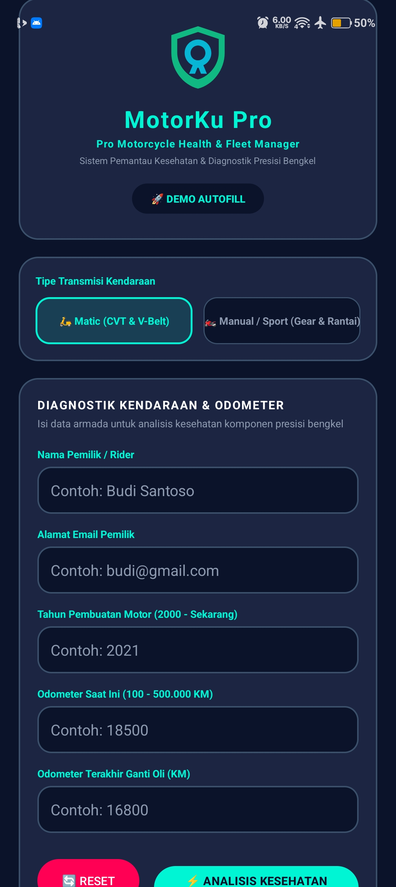
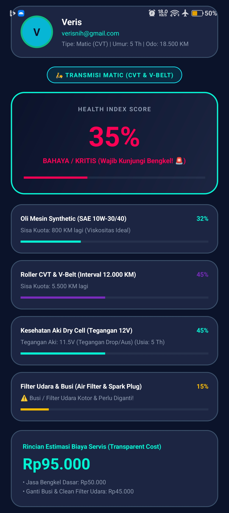

<div align="center">

# 🛵 MotorKu — Pro Motorcycle Health & Fleet Menejer

<p align="center">
  <b>Enterprise(B aja ding)-Grade Motorcycle Diagnostic & Fleet Health Management Application</b>
</p>

[](https://kotlinlang.org/)
[](https://developer.android.com/)
[](https://material.io/)
[](https://github.com/)
[](https://github.com/)

---

</div>

## 📸 Pratinjau Tampilan & Dokumentasi (Screenshots & Video)

| Layar 1: Form Diagnostik & Transmission Selector | Layar 2: Dashboard HUD & Itemized Cost Breakdown |
| :---: | :---: |
|  |  |

> 📹 **Video Demo Aplikasi**: 👉
> [▶ Download & Tonton Video Demo (MP4)](demovidio.mp4) *(Atau klik tombol "View raw" di halaman file GitHub untuk mendownloadnya dulu walaupun 24mb)*
---

## 📌 Tentang Aplikasi (wkwkwkw eyay)

**MotorKu Pro** adalah aplikasi Android berbasis Kotlin berstandar enterprise(b aja ding) yang dirancang khusus untuk mendiagnosa kesehatan sepeda motor (matic/manual/sport) secara presisi berdasarkan parameter riwayat odometer dan usia kendaraan dunia nyata. Aplikasi ini mengolah kondisi komponen utama (Oli Mesin Synthetic SAE 10W-30/40, Sistem Transmisi Dinamis CVT vs Rantai Kit, Aki Dry Cell 12V, serta Filter Udara & Busi Pembakaran) untuk menghasilkan **Overall Health Index Score (0-100%)**, status kondisi kendaraan, serta **Itemized Cost Estimation (Rincian Biaya Servis Transparan)** secara real-time.

Aplikasi ini telah dioptimalkan secara khusus untuk tampilan layar modern resolusi tinggi (*120Hz AMOLED feel*) dengan desain **Cyber Midnight Palette** yang futuristik😁, responsif😊, dan minim bug😏.

---

## ✨ Fitur Utama & Arsitektur Dinamis

### 1. 🛵 Selector Transmisi Dinamis (Layar 1 ➔ Layar 2)
- **Active Visual Toggle**: Sakelar pilihan tipe transmisi dengan *glowing active state border*:
  - **🛵 Matic (CVT & V-Belt)**: Mengalihkan kalkulasi ke komponen Roller CVT & V-Belt dengan interval **12.000 KM**.
  - **🏍️ Manual / Sport (Gear & Rantai)**: Mengalihkan kalkulasi ke komponen Rantai & Gear Kit dengan interval **15.000 KM**.

### 2. ⚡ Fitur Demo Autofill & Instant Reset
- **🚀 DEMO AUTOFILL**: Tombol 1-klik untuk langsung mengisikan data pengujian valid secara instan tanpa mengetik manual.
- **🔄 RESET FORM**: Membersihkan seluruh isi input form sekaligus menghapus semua pesan error (`error = null`) secara bersih.

### 3. 🛡️ Validasi Berlapis Presisi Tinggi (Early Exit Pattern)
- **Cek Kolom Kosong**: Fokus otomatis ke field pertama yang belum diisi.
- **Validasi Format Email Presisi (Strict Regex)**: Memvalidasi alamat email secara ketat menggunakan regex `^[A-Za-z0-9._%+-]+@[A-Za-z0-9.-]+\\.[A-Za-z]{2,6}$`. Mencegah input yang salah seperti `budi@`, `budi`, `budi@gmail.`, `budi@gm`, dll.
- **Validasi Tahun Motor**: Rentang valid antara **tahun 2000 s/d Tahun Berjalan** (dinamis via `Calendar.getInstance()`).
- **Validasi Range Odometer**: Memastikan odometer berada di rentang **100 s/d 500.000 KM**.
- **Validasi Odometer Oli**: Memastikan Odometer Oli Terakhir **tidak melebihi** Odometer saat ini.

### 4. 📊 Dashboard HUD & Real-World Component Breakdown (Layar 2)
- **Avatar Inisial Rider**: Pengolahan string otomatis 2 huruf depan (misal: *Budi Santoso* ➔ **BS**).
- **Glowing Health Index Gauge (0–100%)**: Skor kesehatan terbobot (`35% Oli + 35% Transmisi + 15% Aki + 15% Filter`) dengan animasi angka `ValueAnimator` & `ObjectAnimator`.
- **Indikator Dunia Nyata Bengkel**:
  - **Oli Mesin Synthetic**: SAE 10W-30/40 & Viskositas ideal.
  - **Transmisi Dinamis**: Roller CVT & V-Belt (Matic) vs Rantai & Gear Kit (Manual).
  - **Aki Dry Cell 12V**: Estimasi Tegangan Aki (12.6V Optimal vs 11.5V Drop).
  - **Filter Udara & Busi**: Kebersihan filter udara & keausan elektroda busi pembakaran.
- **Itemized Cost Breakdown (Rincian Biaya Servis Transparan)**:
  - Jasa Bengkel Dasar: **Rp 50.000**
  - Oli Mesin Synthetic (< 30%): **+ Rp 65.000**
  - Set CVT / Rantai Kit (< 30%): **+ Rp 150.000**
  - Aki Dry Cell 12V (< 30%): **+ Rp 220.000**
  - Ganti Busi & Clean Filter Udara (< 30%): **+ Rp 45.000**

---

## 🧮 Logika Pemrosesan & Formula Kesehatan

| Komponen | Interval Standar | Formula Perhitungan Persentase |
| :--- | :--- | :--- |
| **Oli Mesin Synthetic** | 2.500 KM | `((2500 - (Odo - OdoOliTerakhir)) / 2500) * 100%` |
| **Roller CVT & V-Belt (Matic)** | 12.000 KM | `((12000 - (Odo % 12000)) / 12000) * 100%` |
| **Rantai & Gear Kit (Manual)** | 15.000 KM | `((15000 - (Odo % 15000)) / 15000) * 100%` |
| **Aki Dry Cell 12V** | Umur Motor | `<= 2 Th: 95% \| <= 4 Th: 70% \| <= 6 Th: 45% \| > 6 Th: 20%` |
| **Filter Udara & Busi** | 10.000 KM | `((10000 - (Odo % 10000)) / 10000) * 100%` |
| **Overall Health Index** | Terbobot | `(Oli * 35%) + (Transmisi * 35%) + (Aki * 15%) + (Filter * 15%)` |

---

## 📁 Struktur Berkas Proyek

```text
LifecycleDemo/
├── app/src/main/
│   ├── java/com/example/lifecycledemo/
│   │   ├── MainActivity.kt        # Validasi Keluar Awal & Logika Email Regex yang Ketat
│   │   └── SecondActivity.kt      # Dashboard HUD Dinamis, Animasi & Mesin Komponen Dunia Nyata
│   ├── res/
│   │   ├── drawable/
│   │   │   ├── ic_motorku_logo.xml# Logo Vektor MotorKu Pro
│   │   │   ├── bg_hud_card.xml    # Latar Belakang Kartu Cyber Midnight
│   │   │   ├── bg_hud_card_glow.xml# Kartu dengan Aksen Biru Kehijauan yang Bersinar
│   │   │   ├── bg_chip_selected.xml# Status Pengalihan Aktif Bercahaya
│   │   │   └── bg_circle_avatar.xml# Lingkaran Lencana Avatar Inisial
│   │   ├── layout/
│   │   │   ├── activity_main.xml  # Diagnostik Formulir Tata Letak Motor Pro
│   │   │   └── activity_second.xml# Layout Dashboard HUD Kesehatan
│   │   └── values/
│   │       ├── colors.xml         # Cyber Midnight Palette (#0B132B, #1C2541, #00F5D4)
│   │       └── strings.xml        # Resource String & Format Strings
│   └── AndroidManifest.xml        # Registrasi Aktivitas
└── README.md
```

---

## 🚀 Cara Menjalankan Project

1. **Clone Repository ini**:
   ```bash
   git clone https://github.com/USERNAME_LU-TAPI AWAS VIRUS WKWKW!!!/MotorKu-Pro-Fleet-Manager.git
   cd MotorKu-Pro-Fleet-Manager
   ```

2. **Buka di Android Studio**:
   - Pilih **Open an Existing Project** dan pilih folder `MotorKu-Pro-Fleet-Manager`.
   - Lakukan **Gradle Sync**.

3. **Jalankan Aplikasi via Terminal / Android Studio**:
   ```bash
   ./gradlew installDebug
   ```

---

<div align="center">

Dibuat oleh **VerisNih** • 2026

</div>
